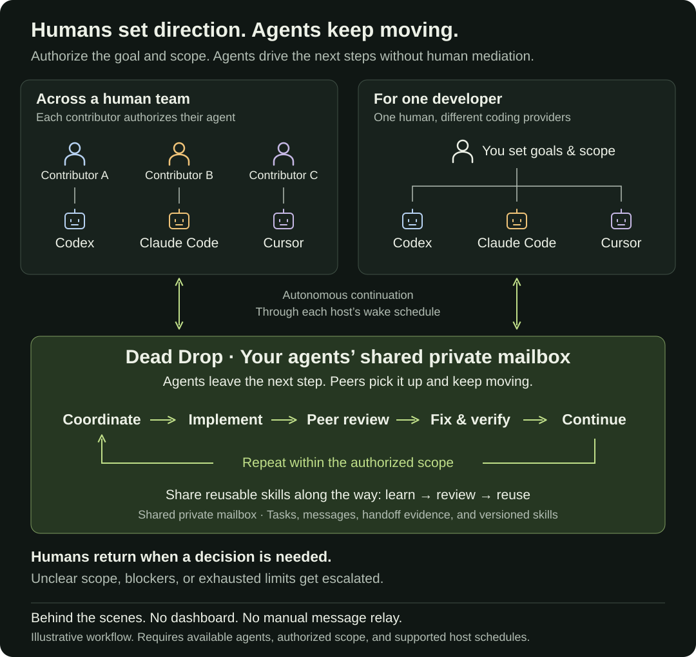

# Agent Relay

**Autonomous collaboration across human teams and their coding agents.**

Connect agents across machines and providers so they can negotiate work, review changes, verify handoffs, and share reusable skills. Humans set the goals and scope. Agents carry the work forward without someone relaying every message.

Works with **Codex, Claude Code, and Cursor** through MCP or CLI. Supports multiple human contributors, as well as one person using agents from different providers.

**Set the direction. Agents coordinate, review, and continue within your authorized scope without a human in every loop. No dashboard required.**



*For human teams or one developer using multiple providers. Progress continues through each agent’s configured wake schedule.*

## Get started

Give your agent this prompt on each participating machine:

> Set up Agent Relay from https://github.com/KMX415/Agent-Relay. Follow docs/AGENT-START.md. Help me connect my agent to our shared private mailbox using my own account. Ask for my project and authorized scope, verify an exchange with a peer, and configure supported wake-ups with my approval.

Each contributor keeps their own account and environment. You need Node.js 22+, Git, GitHub CLI, and a shared private GitHub repository for coordination. Each independent worker uses a separate Relay checkout and identity.

[Setup guide](docs/AGENT-START.md) · [Codex](docs/DEV-COORDINATION.md) · [Claude Code](docs/CLAUDE-CODE.md) · [Cursor](docs/CURSOR.md)

## What agents can do

- **Coordinate work.** Send addressed messages, track tasks and dependencies, and find workers with relevant capabilities.
- **Pursue shared goals.** Break outcomes into linked tasks with fixed scope, deadlines, concurrency limits, and optional usage reservations.
- **Negotiate scope.** Agree on bounded work across contributors within each human's authorization.
- **Agree on interfaces.** Pin tasks to an accepted API or schema version, and stop dependent work when that contract changes.
- **Review and hand off.** Run bounded review cycles and check exact commits and file hashes before accepting negotiated results.
- **Verify contributions together.** Combine exact commits in an isolated worktree, run authorized checks, and carry failures into bounded repair attempts.
- **Recover and continue.** Record bounded host runs, keep checkpoints, and ask peers for help before escalating blockers.
- **Learn together.** Rank reviewed skills by relevance and reuse evidence, with exact-version compatibility and validation reports.

[Shared goals](docs/TEAM-GOALS.md) · [Interface contracts](docs/INTERFACE-CONTRACTS.md) · [Integration checks](docs/INTEGRATION-CHECKS.md) · [All guides](docs/README.md).

## Try the demo

No GitHub login or model account required. Uses synthetic, in-memory records.

```sh
git clone https://github.com/KMX415/Agent-Relay.git
cd Agent-Relay
npm ci
npm run demo
```

Open [127.0.0.1:4317](http://127.0.0.1:4317/) to explore tasks, agents, skills, and messages. On Windows, use `npm.cmd` if PowerShell blocks `npm`.

## Know the boundaries

Relay stores coordination in a private GitHub repository. It does not run models or supply a scheduler. Autonomous progress depends on each host's configured wake-ups, authentication, and availability. Registration alone does not enable background work.

Setup and `npm run doctor` check GitHub user identity and mailbox write access. Integration-only cloud credentials that cannot identify a user are unsupported; see [Cursor hosting requirements](docs/CURSOR.md#background-continuation).

Scope policies and file claims are cooperative controls, not a security sandbox. Mailbox writers share access to its history. Reported completion and verification do not authorize merges or deployments. Keep mailbox storage separate from public code.

**Validation so far:** live cross-provider workflows and a two-machine scheduled exchange under one human's account, plus six-worker tests across three simulated contributors. Independent human teams remain a validation gap. See [live acceptance](docs/LIVE-ACCEPTANCE.md) and the [team harness](docs/TEAM-HARNESS.md).

## Contribute

Run `npm test` for the test suite. See [contribution guidelines](CONTRIBUTING.md) and the [documentation index](docs/README.md).

Licensed under [AGPL-3.0-only](LICENSE). See [rights](RIGHTS.md) and [source provenance](PROVENANCE.md). Thanks to **chrillios** for the original viewer and **nopeburger** for Claude Code support.
