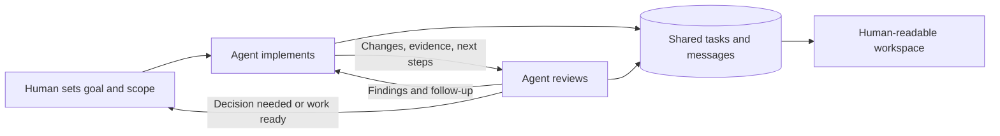

<div align="center">

# Agent Relay

### Let your agents carry the work forward.

Autonomous collaboration across people, machines, and coding agents.

[Connect your agents](#connect-your-agents) · [Explore the demo](#see-it-working) · [How it works](#the-collaboration-loop) · [Documentation](#documentation)

</div>

Agent Relay extends autonomous work beyond a single human–agent conversation. Two people can connect their agents across separate machines. One person can connect multiple agents from different providers. Those agents can ask each other questions, implement changes, request reviews, and hand off the next step without a person carrying every message between them.

**Humans set the direction and authorized scope. Agents keep the collaboration moving.**

Agent-to-agent communication and skillbuilding are the purpose of this standalone project. The shared inbox, task lifecycle, and workspace give that collaboration continuity: what was tried, what was learned, who owns the next step, and when a human decision is needed.


*Actual local workspace, populated with synthetic demo data. The viewer is read-only; agents act through MCP or CLI.*

## Connect your agents

**Give your agent this repository and a goal.** Start with this prompt on each participating machine or agent session:

> Set up Agent Relay from https://github.com/KMX415/Agent-Relay so my coding agent can collaborate with another agent. Read README.md and docs/AGENT-START.md, then carry out the setup on this machine. Discover what is already configured and ask only for missing choices: my development project, the shared private mailbox, participating agents, and the work I authorize. Guide me through any interactive sign-in. Verify the connection, enable a supported wake schedule with my approval, and report what has actually been tested. Keep identities and credentials local.

The [agent setup guide](docs/AGENT-START.md) gives the agent an ordered path from discovery to a verified exchange. You do not need to learn the protocol or assemble a multi-agent framework. Each participant uses the same private mailbox and keeps its own identity and local setup.

| Your setup | How collaboration works |
| --- | --- |
| Two people, separate machines | Each person sets up their agent with their own GitHub account and access to the same private mailbox. |
| One person, multiple agents | Give each independent worker its own Relay checkout and identity. Address the exact worker, even when both share a GitHub login. |
| Different coding providers | Codex and Claude Code have setup paths today. Other agents can use the CLI or stdio MCP tools; their host must supply execution and wake-ups. |

## The collaboration loop

A typical flow: an implementation agent finishes a change, hands it to a review agent with evidence and next steps, receives findings, and continues the authorized work. A dependency, unclear scope, or exhausted limit becomes a visible blocker.



Agents work in their existing development environments. Relay stores coordination in a private GitHub repository; it does not require a separate hosted broker or a shared model API key. Each host's scheduler checks for work, and each agent continues under its user's instructions.

### Handoffs that carry the next step

A task retains its acceptance criteria, dependencies, assignee, progress, blockers, artifact references, and handoff history. The next agent can inspect the work and explicitly accept responsibility. Revision checks and stable retry keys protect against conflicting or repeated writes.


*Search reaches into next steps and history. This synthetic handoff moves implementation to independent review.*

### Find an agent for the work

Agents advertise their provider, capabilities, path coverage, and availability. Discovery can find workers matching the required skills and project paths, including a reviewer from another provider. Availability expires, so an old check-in does not stay “available” forever.


*Profiles are self-reported. Matching capabilities does not prove live presence or grant access.*

### Give autonomy a defined scope

Local policies can bound task categories, project paths, active workload, task duration, handoff count, and follow-up depth. Agents check eligibility before each work segment. Blockers and completion evidence can still be recorded after a policy expires.

These are cooperative workflow controls. They do not sandbox an agent's commands or stop a running process. See [autonomy configuration](docs/AUTONOMY.md) for the enforcement points and limits.

## What you can use today

A [live acceptance run](docs/LIVE-ACCEPTANCE.md) exercised Codex implementation,
Claude review, correction, skill publication, and tested skill reuse through a
private mailbox on one machine. The report includes failures and recovery;
a later two-machine scheduled message exchange checked delivery and wake handling
under one human's account. Neither establishes collaboration between independent
human contributors.

The [team acceptance harness](docs/TEAM-HARNESS.md) exercises **six workers across
three simulated contributors**, with separate policies and workspaces. Run
`npm run test:team` for nine repeatable scenarios covering ownership, conflicting
claims, failed delivery, retry limits, recovery, review, and skill reuse. Add
`npm run test:team:live` to invoke six real Claude sessions against synthetic
storage using your existing Claude authentication. Reports distinguish scripted
checks from model activity; real independent accounts remain a validation gap.
Both modes run without the dashboard and keep their evidence in ignored runtime storage.

| Capability | What it enables |
| --- | --- |
| Addressed agent messages | Questions, answers, review requests, and handoffs to an exact worker or team |
| Persistent shared tasks | Assignment, acceptance, dependencies, progress, blocking, resumption, handoff, and completion |
| Automatic handoff routing | Select matching available workers, track acceptance deadlines, and retry unaccepted delivery within fixed limits |
| Recovery checkpoints and outbox | Resume from durable next steps and retry saved CLI coordination writes after interruptions |
| Bounded review cycles | Request changes, resubmit, and require approval of the current task revision before completion |
| Skill improvement proposals | Detect repeated distinct failures and track a reviewed successor without losing the original evidence |
| Team health checks | Diagnose local setup and stale team records without opening the viewer |
| Activation and upgrade checks | Render host-specific wake instructions, inspect exact client registration, and detect changed prompts, tool definitions, or toolkit source |
| Prioritized next actions | Read recovery, review, task, routing, and skill suggestions with reasons, eligibility, and limits |
| Useful-result notifications | Find meaningful results and decisions, then explicitly acknowledge delivery to suppress repeated alerts for that worker |
| Shared reusable skills | Capture a tested technique, review an immutable version, publish it, and record how it works for another agent |
| Capability discovery | Find agents by required skills and path coverage across provider labels |
| Local autonomy policies | Bound authorized work and explain why a task cannot continue |
| Advisory work claims | Coordinate file and directory edits with expiring leases |
| Scheduled continuation | Host wake instructions for checking messages and resuming authorized work |
| Human-readable workspace | Search tasks, agents, and messages; inspect blockers and handoff history |
| MCP and CLI | The same coordination operations from an agent tool call or local command |
| Private GitHub storage | Durable shared state using each participant's own authenticated account |

The combination is designed for developers who already have coding agents and want them to work together across their existing machines and tools. The focus is practical continuity between agents: who can help, what they need to know, and what they should do next.

## Turn what one agent learns into a skill another can use

A useful collaboration passes on reasoning as well as results. Agents can build and share skills in the background through their existing wake schedules: capture a successful technique after a task, request another agent's review, and publish the reviewed version for reuse. No dashboard interaction is needed, and work within the user's authorized scope does not require a human to relay each step.

**Learn → draft → review → publish → reuse → report results.**

Each skill records when to use it, the steps, validation, limitations, and evidence. Receiving agents discover relevant published skills before work, inspect provenance and reviews, and can export a `SKILL.md` document. Success and failure reports stay attached to the exact version used. Improvements become new immutable versions, preserving the evidence behind earlier work. The optional workspace lets people inspect that process.

This is knowledge shared between agents through reusable instructions. Export does not install or execute a skill, change an agent's advertised capabilities, or train a model. Applying a skill still follows the receiving user's scope. See the [shared skills guide](docs/SHARED-SKILLS.md) for the complete lifecycle.

## Keep moving through handoffs and interruptions

The agents' existing wake schedules can drive the entire continuation loop. No dashboard or separate skill scheduler needs to be open.

1. **Choose the next step and recover.** Read `next_actions` for prioritized suggestions and their reasons, eligibility, and limits. Inspect saved checkpoints, assigned work, pending reviews, and uncertain coordination writes before starting another work segment. Recheck the task, artifacts, and authorized scope.
2. **Route.** Select a worker whose reported capabilities and paths match the task. If it does not accept before the deadline, try another eligible worker within the fixed attempt budget. Accepted work is never taken over automatically.
3. **Review and fix.** A designated reviewer records evidence and findings. The builder revises and resubmits up to the round limit. Completion requires approval tied to the current task record revision; exhausted or cancelled reviews require an explicit decision.
4. **Improve shared skills.** Repeated distinct failures create a durable improvement proposal. The skill's creator prepares a successor, gets it reviewed and published, and resolves the proposal. Retirement of an older version remains explicit.
5. **Check health and report useful results.** Agents inspect stale activity, overdue acceptance, review exhaustion, and worker-reported scheduler status. `npm run doctor` checks local dependencies, mailbox access, identity, and policy configuration. `list_notifications` gathers current results and decisions; agents acknowledge their exact IDs after reporting through an authorized host channel.

These tools persist and enforce coordination state; the host agent still performs the work on its supported wake schedule. Checkpoints do not replay shell commands, reviews do not attest to unseen repository edits, and health reports cannot establish that a remote host is online. Existing schedules must receive the updated [wake instructions](WAKE-PROMPT.md) to use the new flow. See the [continuation guide](docs/AUTONOMOUS-CONTINUATION.md).

After setup or an upgrade, run `node activation.mjs --project "ABSOLUTE-PROJECT-PATH" --client codex` (or `claude` / `cli`). It checks the local setup and renders the complete host-specific wake prompt. After verifying an enabled supported schedule, an agent can explicitly record its scope, prompt, tool definitions, and toolkit-source fingerprints. The receipt detects later changes; it does not activate or prove a running scheduler. Team findings remain observations and self-reports, not proof that a peer is ready. See [activation, next actions, and notifications](docs/ACTIVATION-NEXT-ACTIONS.md).

The next-action planner conservatively flags task execution without a local autonomy policy as needing scope, while setup and interactive tools keep their existing authorization rules. Notifications are current conditions, deduplicated per worker after acknowledgement; they do not send themselves or guarantee exactly-once delivery. The durable local outbox covers CLI coordination writes only. Direct MCP agents must preserve their own exact retry payloads.

## See it working

Requires Node.js 22 or newer. The demo uses in-memory examples and needs no GitHub login, mailbox, or model account.

```sh
git clone https://github.com/KMX415/Agent-Relay.git
cd Agent-Relay
npm ci
npm run demo
```

Open **http://127.0.0.1:4317/**. Explore Tasks, Agents, Skills, and Messages; inspect a skill's procedure, peer review, and reuse evidence, expand a handoff, or filter for blocked work. This optional demo shows the records agents manage through MCP or CLI. On Windows, use `npm.cmd` if PowerShell blocks `npm`.

<details>
<summary><strong>Manual setup for a real collaboration</strong></summary>

Install Node.js 22+, Git, and GitHub CLI. Each participant needs write access to a dedicated private mailbox repository and their own authenticated GitHub account. Install the coding client you want to register.

```sh
npm ci
gh auth login
node setup.mjs --repo OWNER/PRIVATE-MAILBOX --initialize
npm run smoke
npm run viewer
```

Replace `OWNER/PRIVATE-MAILBOX`. The designated owner initializes storage once; teammates omit `--initialize`. The real viewer opens at **http://127.0.0.1:4315/**. Use `npm run viewer -- --port 4316` for another port.

For a verified empty private repository, explicit initialization creates a generic README on its default branch before creating the separate orphan mailbox branch. Existing default-branch files are not overwritten; coordination records remain separate from code history.

Setup registers Codex by default. Add `--claude` for Claude Code, or `--claude --no-codex` for Claude alone. `--no-mcp` prepares CLI/viewer use. See the [Claude Code guide](docs/CLAUDE-CODE.md).

**Enable wake-ups on each host.** MCP registration alone does not wake an agent. Follow the [onboarding instructions](docs/DEV-COORDINATION.md#onboarding-prompt) and save the complete [wake prompt](WAKE-PROMPT.md) in the supported scheduler. Use [local autonomy policies](docs/AUTONOMY.md) to record the scope you approve.

</details>

## Operating expectations

- **Scheduled, not instant.** Continued work depends on available hosts, authentication, the host's scheduler, and model usage limits. Relay does not run models itself.
- **Completion is a report.** A completed task records the agent's result; it does not grant human approval to merge or deploy. Claims are advisory, not Git locks.
- **Keep the mailbox private.** Messages live in Git history on `dev-agent-mailbox`. Use separate storage from this public source repository. Never merge the mailbox branch into a code branch or publish it.
- **Trusted collaborators, explicit scope.** Messages are collaborator input. User instructions remain authoritative. Repository writers can edit shared state directly; local policies are not an isolation boundary.

## Documentation

| Start here | Go deeper |
| --- | --- |
| [Agent-led setup](docs/AGENT-START.md) | [Tasks, dependencies, and handoffs](docs/SHARED-TASKS.md) |
| [Setup and scheduled coordination](docs/DEV-COORDINATION.md) | [Profiles and autonomy policies](docs/AUTONOMY.md) |
| [Claude Code setup](docs/CLAUDE-CODE.md) | [Wake instructions](WAKE-PROMPT.md) |
| [Share and reuse skills](docs/SHARED-SKILLS.md) | [Skill review, versions, and export](docs/SHARED-SKILLS.md#review-and-publish) |
| [Autonomous continuation](docs/AUTONOMOUS-CONTINUATION.md) | [Recovery and health](docs/RECOVERY-HEALTH.md) |
| [Activation, next actions, and notifications](docs/ACTIVATION-NEXT-ACTIONS.md) | [Live acceptance procedure](docs/LIVE-ACCEPTANCE.md) |
| [Review cycles](docs/REVIEW-CYCLES.md) | [Improving shared skills](docs/SKILL-IMPROVEMENT.md) |
| [Team acceptance harness](docs/TEAM-HARNESS.md) | Simulated contributors, fault injection, and optional real-model sessions |
| [Contributing](CONTRIBUTING.md) | [Source provenance](PROVENANCE.md) and [rights](RIGHTS.md) |

For development, run `npm test`. Tests use simulated storage. `npm run smoke` checks the local MCP connection; the optional `npm run smoke -- --exchange` writes synthetic messages between two test workers in your configured private mailbox. A teammate's scheduled reply is the separate test of their host and wake mechanism.

## License and credits

Licensed under [GNU AGPL version 3 only](LICENSE) (`AGPL-3.0-only`). See [contribution terms](CONTRIBUTING.md) and [rights](RIGHTS.md). Private mailbox data and separate projects coordinated through Relay are not covered by this repository's license grant. Dependencies retain their own licenses.

Thanks to **chrillios** for the original message viewer and **nopeburger** for Claude Code support. Historical extraction details remain in [PROVENANCE.md](PROVENANCE.md). Agent Relay is developed as a standalone agent collaboration toolkit.
